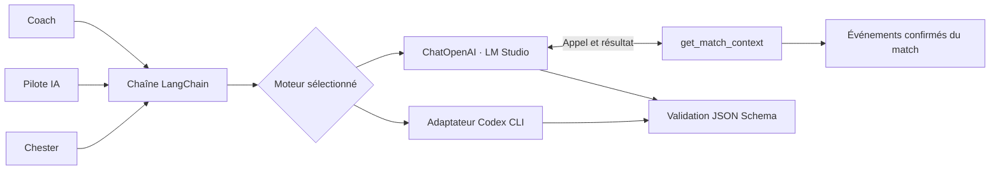

# Salon web et MCP

## Démarrage local

Installer les dépendances du coach, du pilote IA et de Chester dans le Python
utilisé par le lanceur (Python 3.11 ou supérieur) :

```powershell
python -m pip install -r requirements-ai.txt
```

Double-cliquer `Lancer InazumIA.cmd`. Le lanceur construit ou vérifie la ROM
d'arène, démarre le serveur sur `127.0.0.1:18765` et ouvre le navigateur.
La première ouverture initialise une nouvelle partie dans melonDS ; cette
préparation peut prendre environ une minute. Sa progression reste visible dans
le salon. Les commandes suivantes partagent ce même processus d'émulation.

Le chat appelle un agent organisateur avec le moteur sélectionné. Il résout les deux équipes et écrit
six répliques originales, alternant les capitaines. La préparation manuelle
propose un dialogue court prédéfini si l'on ne souhaite pas appeler cet agent.
Le catalogue propose Raimon, Royal Academy, Occulte, Zeus, Genesis et les
Empereurs noirs à domicile comme à l’extérieur.

« Lancer le dialogue » ouvre l'échange dans le jeu. « Continuer » fait avancer
le temps ; « Pause » l'arrête. Le clavier, les boutons DS et les clics/glissers
sur l'écran inférieur commandent le même worker. Les coordonnées DS vont de
0 à 255 en x et de 0 à 191 en y, exclusivement sur l'écran inférieur.

Le salon de bureau utilise une échelle de 125 % à partir de 1000 pixels de
largeur ; conserver le zoom du navigateur à 100 % pour cette taille. Les deux
écrans sont intégrés dans une DS blanche dessinée en CSS pixel art. Les éléments
de sa coque sont décoratifs ; les commandes restent disponibles dans « À la
manette », au clavier et sur l'écran tactile inférieur.

La lecture humaine envoie deux frames DS par requête, avec une cible de
30 affichages par seconde (60 frames DS/s). Les requêtes sont séquentielles :
une machine lente ne cumule pas de commandes. Le suivi du statut reprend en
pause ; pendant la lecture, les réponses des commandes actualisent l'écran.

« L'agent joue pour moi » utilise un pilote local sans appel à un modèle :

- Le worker publie les identifiants des transitions reconnues et vérifie
  la session, la révision, la frame et la légalité avant chaque action.
- Sans action proposée, le pilote avance par lots de 60 frames, puis relit
  l'état. Si la progression reste bloquée, il rend la main et consigne la
  phase, l'écran et la frame.
- Pour un duel reconnu, le pilote choisit une option du menu et le worker
  l'exécute par le tactile DS. Pour la consigne de passe reconnue, il exige
  aussi la possession de l'équipe contrôlée, lue dans la RAM.
- Les commandes directes en RAM et les autres actions de jeu libre restent
  à valider. Le pilote peut rendre la main avant la fin du match.

La lecture mémoire fournit les positions terrain des joueurs, le ballon, son
porteur, le score et le chrono natif (ticks/30). Le chrono ne sert jamais à
déduire une fin de match ; son changement de période n'est pas encore validé.
Les signatures de code ARM9, les pointeurs et les champs actifs sont
contrôlés ; une observation non validée conserve des champs inconnus. Les menus
sont reconnus par deux signatures de régions de pixels locales : leur provenance
est distincte de celle des mesures en mémoire. Aucune image n'est envoyée au
modèle pour une règle ou un choix texte.

La projection caméra et le joueur contrôlé restent à valider. Pour les menus
reconnus, le worker traduit l'identifiant de la transition en entrée DS.

« Reprendre la main » interrompt le pilote et rend le contrôle humain.
Chaque commande d'avance est limitée à 120 frames. Quatre frames de
relâchement séparent les appuis et les glissers
pour que le jeu échantillonne le relâchement même pendant ses mises à jour à 30 Hz.
Un segment peut s'arrêter avant sa limite lorsque le résultat final est détecté ;
la frame reste alors figée jusqu'au retour au salon.

« Nouvelle rencontre » restaure le checkpoint initial du worker : la ROM n'est
ni reconstruite ni rechargée. Une nouvelle affiche et de nouveaux dialogues
peuvent alors être injectés. Les checkpoints utilisateur restent éphémères et
appartiennent exclusivement à la session courante.

À l'écran natif « Fin du match », le contrôleur conserve le résultat et suspend
le cœur. « Nouvelle rencontre », B ou un clic de continuation rétablit le salon
depuis le checkpoint de cette même session. Ce retour est géré par le worker :
le retour natif direct de cette arène a provoqué un crash pendant les essais et
n'est pas utilisé. La ROM d'arène doit donc être jouée avec ce contrôleur, et
non comme une ROM autonome dans un autre frontend.

## Architecture IA



Le coach et le pilote définissent leurs consignes et schémas dans
`src/agent_runtime.py`. Chester définit sa réaction dans `src/chester.py`.
Chaque appel passe par la même chaîne LangChain dans `src/ai_generation.py`.
Elle invoque le moteur, décode le JSON, valide le schéma et vérifie l’annulation
avant de rendre le résultat. Les journaux restent dans `build/agents`.

Le salon appelle LM Studio en local via `ChatOpenAI`. Quand Codex est sélectionné
dans le parcours MCP, un adaptateur LangChain invoque le CLI avec sa configuration
existante. Le pilote déterministe applique les règles du jeu sans appeler de
modèle. Le navigateur lit les commentaires via la synthèse vocale du système.

Au coup d’envoi, sur un but, à la mi-temps ou au résultat, le salon diffuse
l’annonce confirmée immédiatement. En parallèle, Chester demande au modèle
local d’appeler une fois `get_match_context`. L’outil lit le score, le chrono
et jusqu’à trois événements confirmés au moment de l’action. Le modèle reçoit
le résultat et formule une réaction courte. Le salon affiche l’appel, le score
lu et la réaction validée. Chaque appel exécuté produit un journal `tool.json`
avec son résultat et sa durée dans `build/agents/`. Le budget des deux échanges
est de 30 secondes. Si le modèle échoue ou expire, l’annonce initiale suffit.

Pour la démo, lancer Occulte–Zeus avec les sous-titres activés. Au coup d’envoi,
attendre l’affichage de `get_match_context`. Sur le premier but, montrer le
nouveau score lu par l’outil et la réaction de Chester. Laisser LM Studio
chargé avant la démonstration.

## Agents et connexion

Le salon web utilise **LM Studio** pour le chat et le pilote IA.

### IA locale

Démarrer le serveur local dans LM Studio, sur le port 1234, avec le modèle
visuel `qwen/qwen3.5-9b` déjà disponible sur ce PC. Aucun compte ni clé API
n'est requis. Les demandes et captures sont envoyées uniquement au serveur
HTTP de la machine, sans appel à Codex CLI.

Les variables `INAZUMIA_LLM_URL` (défaut `http://127.0.0.1:1234/v1`) et
`INAZUMIA_LLM_MODEL` permettent de choisir un autre serveur compatible ou modèle.
Seules les adresses de boucle locale sont acceptées. Le joueur exige un modèle
visuel ; les deux agents exigent des réponses JSON structurées. Le délai maximal
est de 180 secondes par décision. Annuler rend immédiatement le contrôle ;
l'inférence déjà envoyée peut continuer sur le serveur, mais sa réponse est ignorée.
Les requêtes locales utilisent `reasoning_effort: "none"` pour éviter que Qwen
consomme le budget dans son raisonnement interne. Le salon affiche le temps
d'attente de la décision ; le jeu reste en pause pendant celle-ci. La vitesse
et la qualité des actions dépendent toujours du modèle et du matériel.

### Codex CLI

Ce choix conserve le CLI Codex déjà installé et l'authentification existante.
Vérifier `codex login status` ; si nécessaire, se connecter avec `codex login`.
Chaque décision est une exécution éphémère en lecture seule, sans chargement de
la configuration utilisateur du CLI. Les agents n'ont pas besoin d'une clé API.
Ils consomment l'usage associé à votre compte Codex. Le modèle doit accepter
les images et les réponses structurées. Un échec, un délai dépassé ou un budget
épuisé laisse le jeu en pause et fournit une erreur explicite dans le salon.

Les prompts, sorties et journaux restent dans `build/agents/`. Les sessions
gardent leurs commandes dans `build/sessions/<id>/replay.jsonl`, leurs images
et le journal natif `native.log`. Ces fichiers restent hors Git et du ZIP source.
Le pilote consigne les observations, commandes acceptées, rejets, avances sans
entrée et métriques de fin dans `build/agents/<job>-match.jsonl`. Le statut expose
`rule_actions`, `rejected_commands`, `max_action_gap_seconds`, `text_calls` et
`vision_calls`. La preuve PNG est conservée si l'écran final est atteint.

Vérifications isolées, sans utiliser la session du salon :

```powershell
python -m unittest discover -s tests -p test_*.py
python tests/smoke_hybrid_session.py
python local/replay_pilot.py --rounds 2
```

La boucle rejoue Occulte–Zeus et Zeus–Occulte dans des sessions isolées.
Chaque essai conserve l'état d'arrêt et une capture dans `build/pilot-replays/`.

## Installer et configurer MCP

Installer l'environnement MCP avec les commandes suivantes :

```powershell
python -m venv local/agent-venv
local/agent-venv/Scripts/python.exe -m pip install -r requirements-agent.txt
```

Le SDK officiel est fixé à `mcp==1.30.0`, API v1 :
https://py.sdk.modelcontextprotocol.io/v1/.

L'installateur génère aussi `build/mcp-client.json` et `build/mcp-codex.toml`,
avec les chemins absolus de votre installation. Importer le premier dans un
client compatible, ou ajouter le contenu du second à la configuration Codex.
`python src/configure_mcp.py` régénère ces fichiers si le dossier a été déplacé.

Configurer votre client MCP avec l'exécutable absolu
`<projet>/local/agent-venv/Scripts/python.exe` et l'argument absolu
`<projet>/src/mcp_server.py`. Exemple Codex TOML, en remplaçant les chemins :

```toml
[mcp_servers.inazumia]
command = 'C:\chemin\InazumIA\local\agent-venv\Scripts\python.exe'
args = ['C:\chemin\InazumIA\src\mcp_server.py']
```

Le serveur web doit être ouvert. L'adaptateur MCP est un client du même service
local : il ne crée pas une seconde émulation et son stdout reste réservé à MCP.

Outils : `capabilities`, `list_teams`, `organise_match`, `prepare_match`,
`get_match_status`, `session_open`, `observe`, `observe_match`, `apply_match_action`,
`advance_match`, `start_match`, `step`, `touch_path`,
`checkpoint_save`, `checkpoint_load`, `reset_match`, `delegate_player`,
`stop_player`, `session_close`.

La préparation et les agents renvoient un job ; consulter `get_match_status`
jusqu'à son état terminal. `observe` renvoie une image MCP réelle des deux écrans
et la révision. Une mutation exige cette révision. Avant les commandes directes
du client externe, cliquer « Autoriser le client MCP » dans le salon. L'agent
joueur intégré possède son propre transfert de contrôle.

## Vérification

```powershell
$env:PYTHONPATH = 'src'
python -m unittest discover -s tests -v
python tests/smoke_session.py
local/agent-venv/Scripts/python.exe tests/smoke_mcp.py
python tests/smoke_delivery.py
```

Les deux derniers tests utilisent le service ouvert et modifient sa session.
`smoke_delivery.py` appelle les vrais agents, puis prépare l'affiche inversée
dans le même worker. Il conserve des captures et des identités dans
`build/delivery/`. Une suite de tests verts n'est pas une garantie que le joueur
visuel gagnera un match ; ses décisions et son niveau de jeu restent observables.

Pour exiger aussi un résultat final dans l'essai du joueur visuel, avec un budget
plus long et une durée maximale explicite :

```powershell
python tests/smoke_delivery.py --max-decisions 400 --require-result --timeout 7200
```

Ce mode échoue si l'agent s'arrête avant le résultat ; il ne transforme pas une
limite de budget en réussite de match.
