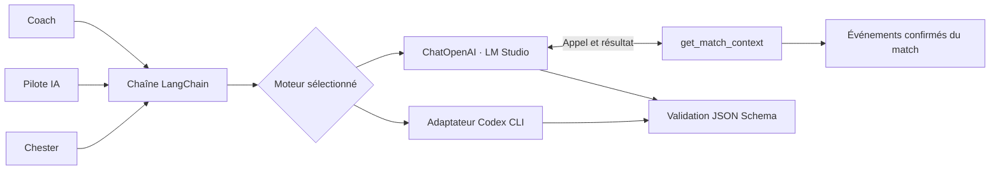

# Salon web et MCP

## Démarrage local

Pour le coach, le pilote IA et les réactions générées de Chester, installer les dépendances dans le Python
utilisé par le lanceur (Python 3.11 ou supérieur) :

```powershell
python -m pip install -r requirements-ai.txt
```

Double-cliquer `Lancer InazumIA.cmd`. Le lanceur construit ou vérifie la ROM
d'arène, démarre le serveur sur `127.0.0.1:18765` et ouvre le navigateur.
La première ouverture initialise une nouvelle partie dans melonDS ; cette
préparation peut prendre environ une minute. Sa progression reste visible dans
le salon. Les commandes suivantes partagent ce même processus d'émulation.

Le chat appelle un agent organisateur avec le moteur sélectionné. Il résout les deux équipes et écrit
six répliques originales, alternant les capitaines. La préparation manuelle
propose un dialogue court prédéfini si l'on ne souhaite pas appeler cet agent.
Le catalogue propose Raimon, Royal Academy, Occulte, Zeus, Genesis et les
Empereurs noirs à domicile comme à l’extérieur.

« Lancer le dialogue » ouvre l'échange dans le jeu. « Continuer » fait avancer
le temps ; « Pause » l'arrête. Le clavier, les boutons DS et les clics/glissers
sur l'écran inférieur commandent le même worker. Les coordonnées DS vont de
0 à 255 en x et de 0 à 191 en y, exclusivement sur l'écran inférieur.

Les commandes DS sont disponibles dans « À la manette », au clavier et sur
l’écran tactile inférieur. Utiliser les flèches ou ZQSD pour les directions,
A/B/X/Y pour les boutons et Entrée pour START. Le bouton **Plein écran**
agrandit la console si le navigateur le permet.

La lecture humaine envoie deux frames DS par requête, avec une cible de
30 affichages par seconde (60 frames DS/s). Les requêtes sont séquentielles :
une machine lente ne cumule pas de commandes. Le suivi du statut reprend en
pause ; pendant la lecture, les réponses des commandes actualisent l'écran.

Dans **Options**, choisir **Pilote déterministe** (par défaut) ou **Pilote IA**, puis cliquer sur **L’agent joue pour moi**.

- Le worker publie les identifiants des transitions reconnues et vérifie
  la session, la révision, la frame et la légalité avant chaque action.
- Sans action proposée, le pilote avance par lots de 60 frames, puis relit
  l'état. Si la progression reste bloquée, il rend la main et consigne la
  phase, l'écran et la frame.
- En mode déterministe, les règles choisissent l’action sans appeler de modèle. En mode IA, le modèle choisit en texte parmi les actions légales quand plusieurs options sont disponibles. Le délai est de 8 secondes. En cas d’échec, de délai dépassé ou de réponse invalide, la règle locale prend le relais.
- Pour un duel reconnu, le pilote choisit une option du menu et le worker
  l'exécute par le tactile DS. Pour la consigne de passe reconnue, il exige
  aussi la possession de l'équipe contrôlée, lue dans la RAM.
- Le jeu libre reste limité aux actions reconnues par le worker. Le pilote peut rendre la main avant la fin du match.

La lecture mémoire fournit les positions terrain des joueurs, le ballon, son
porteur, le score et le chrono natif (ticks/30). Le chrono ne sert jamais à
déduire une fin de match ; son changement de période n'est pas encore validé.
Les signatures de code ARM9, les pointeurs et les champs actifs sont
contrôlés ; une observation non validée conserve des champs inconnus. Les menus
sont reconnus par deux signatures de régions de pixels locales : leur provenance
est distincte de celle des mesures en mémoire. Aucune image n'est envoyée au
modèle pour une règle ou un choix texte.

La projection caméra et le joueur contrôlé restent à valider. Pour les menus
reconnus, le worker traduit l'identifiant de la transition en entrée DS.

« Reprendre la main » interrompt le pilote et rend le contrôle humain.
Chaque commande d'avance est limitée à 120 frames. Quatre frames de
relâchement séparent les appuis et les glissers
pour que le jeu échantillonne le relâchement même pendant ses mises à jour à 30 Hz.
Un segment peut s'arrêter avant sa limite lorsque le résultat final est détecté ;
la frame reste alors figée jusqu'au retour au salon.

« Nouvelle rencontre » restaure le checkpoint initial du worker : la ROM n'est
ni reconstruite ni rechargée. Une nouvelle affiche et de nouveaux dialogues
peuvent alors être injectés. Les checkpoints utilisateur restent éphémères et
appartiennent exclusivement à la session courante.

À l'écran natif « Fin du match », le contrôleur conserve le résultat et suspend
le cœur. « Nouvelle rencontre », B ou un clic de continuation rétablit le salon
depuis le checkpoint de cette même session. Ce retour est géré par le worker :
le retour natif direct de cette arène a provoqué un crash pendant les essais et
n'est pas utilisé. La ROM d'arène doit donc être jouée avec ce contrôleur, et
non comme une ROM autonome dans un autre frontend.

## Architecture IA



Le coach et le pilote définissent leurs consignes et schémas dans
`src/agent_runtime.py`. Chester définit sa réaction dans `src/chester.py`.
Chaque appel passe par la même chaîne LangChain dans `src/ai_generation.py`.
Elle invoque le moteur, décode le JSON, valide le schéma et vérifie l’annulation
avant de rendre le résultat. Les journaux restent dans `build/agents`.

Le salon appelle LM Studio en local via `ChatOpenAI`. Quand Codex est sélectionné
dans le parcours MCP, un adaptateur LangChain invoque le CLI avec sa configuration
existante. Le pilote déterministe applique les règles du jeu sans appeler de
modèle. Le pilote IA ne transmet pas de capture. Le navigateur lit les commentaires via la synthèse vocale du système.

### Commentaire de match

Les **Sous-titres** sont activés au départ. Pour entendre les annonces, activer
**Commentaire vocal** et régler le volume. Le style **Chester** ou **Neuille**
change le ton. La voix dépend de la synthèse vocale du navigateur et du système.

Le worker journalise les événements reconnus, dont le coup d’envoi, les buts,
les duels, les tirs repérés et les changements de possession. La mi-temps et la
fin affichent un bilan établi à partir du score et des événements observés,
avec indication d’un suivi partiel après restauration d’un checkpoint. Les
comptes de tirs et de récupérations portent sur les actions suivies.

Chester peut ajouter une réaction générée. Sur le moteur local, le modèle
appelle « get_match_context » pour lire le score, le chrono, jusqu’à trois
événements récents et le bilan lorsqu’il est disponible. L’appel exécuté est
journalisé dans `build/agents/`. Le budget des deux échanges est de 30
secondes. Les annonces intégrées restent disponibles si le modèle échoue.

## Agents et connexion

Le salon web utilise **LM Studio** pour le chat et le pilote IA.

### IA locale

Le lanceur essaie de démarrer LM Studio et de charger le modèle quand la
commande « lms » est disponible. Sinon, démarrer le serveur local de LM Studio
sur le port 1234 et charger « qwen/qwen3.5-9b », le modèle configuré par défaut.

« INAZUMIA_LLM_URL » (par défaut « http://127.0.0.1:1234/v1 ») et
« INAZUMIA_LLM_MODEL » permettent de changer l’adresse et le modèle. Le serveur
doit écouter sur la boucle locale. Le coach et le pilote IA utilisent du texte
et des réponses JSON structurées. Les réactions de Chester utilisent aussi
l’appel d’outil du modèle local. Les parties manuelles, le pilote déterministe
et les annonces intégrées fonctionnent indépendamment du modèle.

### Codex CLI

Le serveur web lancé normalement utilise le moteur local, y compris pour les
appels MCP qu’il reçoit. L’adaptateur Codex CLI reste disponible côté service
pour les configurations et essais qui le sélectionnent explicitement. Il
utilise une exécution éphémère en lecture seule et l’authentification existante
du CLI.

Les prompts, sorties et journaux restent dans `build/agents/`. Les sessions
gardent leurs commandes dans `build/sessions/<id>/replay.jsonl`, leurs images
et le journal natif `native.log`. Ces fichiers restent hors Git et du ZIP source.
Le pilote consigne les observations, commandes acceptées, rejets, avances sans
entrée et métriques de fin dans `build/agents/<job>-match.jsonl`. Le statut expose
`rule_actions`, `rejected_commands`, `max_action_gap_seconds`, `text_calls` et
`vision_calls`. La preuve PNG est conservée si l'écran final est atteint.

## Installer et configurer MCP

Installer l'environnement MCP avec les commandes suivantes :

```powershell
python -m venv local/agent-venv
local/agent-venv/Scripts/python.exe -m pip install -r requirements-agent.txt
python src/configure_mcp.py
```

Le SDK officiel est fixé à `mcp==1.30.0`, API v1 :
https://py.sdk.modelcontextprotocol.io/v1/.

La dernière commande génère `build/mcp-client.json` et `build/mcp-codex.toml`,
avec les chemins absolus de votre installation. Importer le premier dans un
client compatible, ou ajouter le contenu du second à la configuration Codex.
`python src/configure_mcp.py` régénère ces fichiers si le dossier a été déplacé.

Configurer votre client MCP avec l'exécutable absolu
`<projet>/local/agent-venv/Scripts/python.exe` et l'argument absolu
`<projet>/src/mcp_server.py`. Exemple Codex TOML, en remplaçant les chemins :

```toml
[mcp_servers.inazumia]
command = 'C:\chemin\InazumIA\local\agent-venv\Scripts\python.exe'
args = ['C:\chemin\InazumIA\src\mcp_server.py']
```

Le serveur web doit être ouvert. L'adaptateur MCP est un client du même service
local : il ne crée pas une seconde émulation et son stdout reste réservé à MCP.

Outils : `capabilities`, `list_teams`, `organise_match`, `prepare_match`,
`get_match_status`, `session_open`, `observe`, `observe_match`, `apply_match_action`,
`advance_match`, `start_match`, `step`, `touch_path`,
`checkpoint_save`, `checkpoint_load`, `reset_match`, `delegate_player`,
`stop_player`, `session_close`.

La préparation et les agents renvoient un job ; consulter `get_match_status`
jusqu'à son état terminal. `observe` renvoie une image MCP réelle des deux écrans
et la révision. Une mutation exige cette révision. Pour envoyer directement des entrées depuis un client externe, mettre le jeu
en pause, puis transférer le contrôle par le service HTTP local. Remplacer
`<id>` par l’identifiant renvoyé par `session_open`.

```powershell
Invoke-RestMethod -Method Post -Uri 'http://127.0.0.1:18765/api/set_control' -ContentType 'application/json' -Body '{"session_id":"<id>","owner":"agent"}'
```

Pour rendre le contrôle au navigateur, renvoyer la même requête avec
`"owner":"human"`. Le pilote intégré `delegate_player` prend et libère lui-même
le contrôle. Pour un client qui choisit ses propres actions, lire
`observe_match`, puis soumettre un identifiant légal avec la révision et la
frame observées.

## Vérification

Voir [l’index des vérifications](../verification/VERIFICATION.md) pour les
commandes, les prérequis des essais natifs et les résultats datés.
