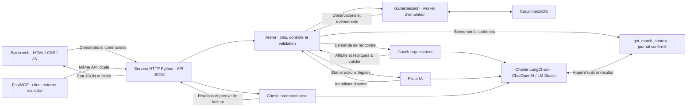

# InazumIA — Soutenance technique

Trame de **8 minutes à deux**, suivie des questions. [Sujet du professeur](sujet_prof.md)

## Déroulé

| Temps | Intervenant | À dire et à montrer |
| --- | --- | --- |
| 0:00–0:45 | A | « InazumIA permet de préparer un match en français, de le jouer dans le navigateur ou d’en déléguer le contrôle. Le match tourne dans melonDS et les commentaires suivent les événements observés. » Montrer le salon. |
| 0:45–2:00 | A | Suivre le diagramme du navigateur jusqu’à l’émulateur. Expliquer les jobs, le retour d’état et le flux vidéo. |
| 2:00–3:15 | B | Expliquer les trois rôles, leurs déclencheurs et le passage de leurs résultats au backend. Montrer la validation et le rôle de LangChain. |
| 3:15–7:15 | A puis B | Envoyer la demande au coach, lancer le dialogue, déléguer le jeu et montrer la preuve d’une action dans l’émulateur. Présenter ensuite la trace de l’outil de Chester. |
| 7:15–8:00 | B puis A | Donner la limite du pilote et une amélioration mesurable. Présenter MCP en une phrase. |

## Architecture à projeter

Le navigateur sert d’interface au jeu. Il envoie les commandes en JSON avec POST, dont `/api/chat` et `/api/delegate_player`. Il consulte `/api/status` et affiche le flux JPEG multipart. Le serveur écoute sur `127.0.0.1:18765`. `Arena` lance les opérations longues en arrière-plan et le navigateur consulte leur statut. `GameSession` pilote le processus qui exécute le cœur melonDS. L’interface et le client MCP accèdent au même état. [Frontend](../web/app.js) · [Serveur HTTP](../src/web_server.py) · [Session](../src/game_session.py)

## Orchestration et preuves

| Rôle | Déclencheur et entrée | Action et preuve |
| --- | --- | --- |
| **Coach** | Le chat transmet la demande et le catalogue des équipes à `MatchAgent.organise`. Le modèle propose deux identifiants et six répliques. | `Arena.chat` vérifie les équipes et enchaîne avec `prepare_match`. Le salon affiche l’affiche prête et le dialogue apparaît dans le jeu. |
| **Pilote IA** | Après délégation, `observe_match` fournit la phase, la frame, la révision et les actions légales. En mode IA, le modèle choisit quand plusieurs options sont disponibles. | Le backend transmet l’identifiant à `apply_match_action`. Le worker vérifie l’état et déclenche l’entrée DS, par exemple la sélection tactile dans un duel. Le changement d’écran et le journal du job attestent l’action. |
| **Chester** | Un événement confirmé déclenche une demande de réaction liée à la session, à l’époque du journal et à l’identifiant de l’événement. | Le modèle local appelle `get_match_context` via `bind_tools`. Le handler renvoie le score, le chrono, jusqu’à trois événements et le bilan si disponible. Le navigateur affiche le nom de l’outil et le score lus lorsqu’une réaction valide revient. |

L’orchestration est pilotée par le backend et les événements du jeu. Le coach prépare la rencontre, le pilote agit sur la session, puis Chester exploite les observations produites pendant le match. Les trois rôles partagent `StructuredGeneration`. Coach et pilote partagent aussi la classe `MatchAgent`. La chaîne invoque le moteur, décode le JSON, valide le schéma et contrôle l’annulation. Pour le coach et le pilote, Python exécute les commandes métier à partir des sorties structurées. Chester effectue directement un appel d’outil côté modèle. Cette distinction répond à la question « quels agents invoquent eux-mêmes un outil ? ». [Orchestration](../src/arena_service.py) · [Deux rôles de match](../src/agent_runtime.py) · [Chaîne LangChain](../src/ai_generation.py) · [Affichage de la trace Chester](../web/chester.js)

## Démonstration

Avant l’oral, lancer `Lancer InazumIA.cmd`, attendre l’initialisation et vérifier que LM Studio répond avec le modèle local chargé. Répéter la séquence jusqu’au premier choix du pilote en mode texte et à l’affichage de `get_match_context`. Garder les sous-titres actifs et régler le volume si vous utilisez la voix. Préparer une capture de l’action et de la trace d’outil issue d’une répétition réussie. [Démarrage et prérequis](guides/WEB_AND_MCP.md#démarrage-local)

1. **A — Coach.** Saisir « Organise un match Zeus à domicile contre Occulte et prépare le dialogue des capitaines. » Montrer l’affiche prête, puis cliquer sur **Lancer le dialogue**. Lire une réplique à l’écran du jeu.
2. **B — Pilote.** Dans **Options**, choisir **Pilote IA**, puis **L’agent joue pour moi**. Montrer qui détient le contrôle. Pendant le match, repérer la ligne Chester dès le coup d’envoi. À un duel, montrer la transition à l’écran et relier la décision `"mode":"text"` à l’entrée `accepted` de même identifiant d’action et de même frame dans `build/agents/<job>-match.jsonl`. Une transition automatique peut s’exécuter sous règles même en mode IA.
3. **B — Chester.** Montrer la ligne `get_match_context · Score …` et la réaction. Les réactions avec contexte peuvent partir du coup d’envoi, d’un but, de la mi-temps ou de la fin. Au besoin, l’onglet Réseau permet de retrouver le champ `tool.context` dans la réponse de `chester_reaction`. Un sous-titre seul peut provenir des annonces intégrées.
4. **A — Reprise.** Cliquer sur **Reprendre la main**, puis montrer que le joueur peut commander le jeu. Arrêter la démo après ces preuves. La fin du match reste facultative.

Si le modèle local décroche, utiliser la préparation manuelle et le pilote déterministe pour poursuivre la démo de l’application. Nommer le mode utilisé et montrer ensuite la capture de répétition pour les preuves propres au modèle. Si le pilote se bloque sur un écran inconnu, reprendre la main et montrer l’état ou le journal du blocage. Une capture complète la démo en direct.

## Bilan et questions

- **Limite et amélioration.** Le pilote dépend des actions reconnues par le worker. En jeu libre, certaines situations restent sans action exploitable. Ajouter des transitions à partir de traces natives annotées, puis mesurer la proportion de matchs qui atteignent l’écran final et le nombre de blocages par scénario.
- **Pourquoi des identifiants d’action ?** Le worker associe un choix métier à une entrée DS connue et rejette une commande si la session, la révision, la frame ou la légalité ont changé. Cela empêche d’appliquer un choix au mauvais état.
- **Que fait le modèle, que font les règles ?** Le modèle compose l’affiche et le dialogue, tranche certains choix tactiques et formule des réactions. La logique applicative valide et applique les mutations. Le pilote IA dispose de 8 secondes par choix et utilise la règle locale en cas d’échec.
- **D’où viennent les observations ?** Les champs validés en mémoire fournissent notamment score, chrono et possession. Des signatures de régions de pixels reconnaissent certains menus. La boucle de démonstration du pilote transmet une observation structurée en texte.
- **Comment fonctionne le bonus MCP ?** Le serveur FastMCP expose en stdio des opérations telles que `list_teams`, `observe_match` et `apply_match_action`. Il les transmet à la même API HTTP. Le pilote local et Chester utilisent leurs propres parcours internes. Le projet présente MCP comme bonus. [Serveur MCP](../src/mcp_server.py) · [Guide MCP](guides/WEB_AND_MCP.md#installer-et-configurer-mcp)
- **Et le recrutement ?** Celia résout une demande par recherche dans le catalogue natif. Le backend valide un brouillon versionné et confirme l’inscription ou la réservation. C’est un parcours applicatif déterministe. [Résolution](../src/recruitment.py) · [Confirmation](../src/arena_service.py)
- **Qu’est-ce qui a été vérifié ?** L’audit du 23 novembre sur `31ff76a` recense 119 tests réussis et 2 ignorés. En pilotage déterministe, Zeus–Occulte a atteint la fin à 1–1 et Occulte–Zeus s’est arrêté sur un écran inconnu. Les parcours complets avec LM Studio et la synthèse vocale restent à répéter avant l’oral. [Vérifications](verification/VERIFICATION.md)

## Barème et preuves à présenter

| Critère | Points | Preuve pendant l’oral |
| --- | ---: | --- |
| Application | 4 | Le salon envoie des commandes au backend. Le vrai match et son état reviennent à l’écran. |
| Architecture multiagent | 5 | Diagramme, trois rôles et déclencheurs, partage de la chaîne LangChain, orchestration Python. |
| Outils et actions | 6 | Dialogue dans l’émulateur, action du pilote appliquée, lecture du score par Chester avec trace visible. |
| Démonstration et soutenance | 5 | Scénario continu, passage de parole, limite concrète et réponses appuyées sur le code. |
